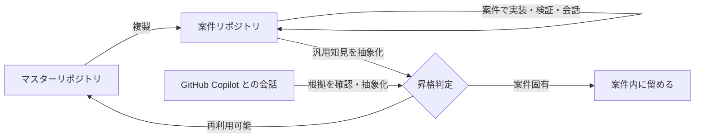

# マスターリポジトリへの知見還元（フィードバックループ）

このリポジトリは、案件ごとに複製して使う **マスターリポジトリ** です。
各案件で得られた汎用的に再利用できる知見を、案件リポジトリや GitHub Copilot との会話からこのマスターへ戻し、
案件を重ねるごとにマスターを育てる運用を前提とします。

> [!IMPORTANT]
> 案件固有の値・要件・成果物はマスターへ戻しません。戻すのは「他案件でも再利用できる形に抽象化したもの」だけです。

---

## 1. 二層構造

| 層                 | 役割                                                           | 例                                                               |
| ------------------ | -------------------------------------------------------------- | ---------------------------------------------------------------- |
| マスターリポジトリ | 再利用可能な標準資産を蓄積する場。案件横断で育て続ける         | スキル、設計パターン、実装テンプレート、検証手順、補助スクリプト |
| 案件リポジトリ     | マスターを複製して個別案件を進める場。顧客要件をここで実装する | 顧客固有 UI、業務フロー、環境設定、案件専用スクリプト            |

開発の流れは「マスターを複製 → 案件で実装・会話で検討 → 汎用知見を抽象化 → マスターへ還元」のループです。



---

## 2. マスターへ昇格する / しないの基準

### 昇格する（マスターへ戻す）

- 複数案件で再利用できるスキル本文・設計パターン・実装手順
- 共通 UI コンポーネント、共通フック、共通ユーティリティ
- 汎用的なデプロイ / 検証 / 調査スクリプト
- 同じ失敗を繰り返さないためのトラブルシュート・教訓
- 公式仕様の変更に追従した恒久的な対応方針

### 昇格しない（案件内に留める）

- 顧客名、テナント URL、環境 ID、接続情報、シークレット、承認フローなどの固有値
- 特定顧客の業務要件・画面・帳票・データモデルそのもの
- 案件限定の暫定ワークアラウンド（恒久対応に昇華できない限り戻さない）
- 検証用のデモデータや一時ファイル

---

## 3. 戻し先マッピング

| 還元する内容                         | 戻し先                                         |
| ------------------------------------ | ---------------------------------------------- |
| スキルの本体手順                     | `.github/skills/{skill}/SKILL.md`              |
| スキルの補足知識・教訓               | `.github/skills/{skill}/references/`           |
| 補助スクリプト                       | `.github/skills/{skill}/scripts/`              |
| 共通 UI 部品・フック・ユーティリティ | `src/components/` / `src/hooks/` / `src/lib/`  |
| 全スキル共通の運用ルール             | `.github/skills/standard/`（本リファレンス群） |
| エージェントの作業ルール             | `.github/agents/`                              |
| 横断的な運用方針の要約               | `README.md`                                    |

配置時は [スキルカタログ](../../README.md) の構成規約・命名規則・YAML フロントマター規約に従います。

---

## 4. 抽象化のルール

そのままコピペで戻さず、必ず「どの前提なら再利用できるか」を明文化して一般化します。

1. 顧客固有値はプレースホルダや環境変数に置き換える（例: 実 ID → `{ENVIRONMENT_ID}`）。
2. 案件名・業務名に依存した表現を、汎用的な役割名に書き換える。
3. 暫定対応は「いつ・なぜ必要か」と「恒久対応の見通し」をセットで残す。
4. 教訓は「やりがちなミス → 正しいアプローチ」の形で再利用しやすく整理する。

### 昇格前の反例テスト

候補を「他案件でも使える」と評価する前に、元の案件と前提が異なる案件を一つ想定して反証する。固有値をプレースホルダーに置き換えただけでは汎用化済みとみなさない。

1. 根拠を「公式仕様・複数案件の実測・単一案件の実測・会話上の提案／推測」に分け、適用範囲と未検証事項を記す。単一案件の成功を全案件の既定値へ昇格させない。
2. ライセンス、契約、認証方式、チャネル、既存資産、運用・納品形態のうち関係する前提を変え、候補が成立しない反例を探す。成立しない場合は必要条件・代替案・判断者を明記する。
3. 候補を「共通原則」「条件付きパターン」「説明用の例」「案件内に留める」「未検証」に分類する。根拠が足りない内容、特定案件の結論や一時的な回避策は、標準の必須手順として採用しない。
4. 既存の標準・スキル・コードと突き合わせ、選定時の既定案と採用後の実装手順、推奨と必須を混同していないか確認する。製品仕様・ライセンスに関する条件は現行の公式情報で再確認する。

反例が見つかっても一律に削除せず、前提を明記すれば有用なものは条件付きパターンにする。前提を明示しても他案件で使う場面が説明できないものは案件内に留める。

---

## 5. 知見還元時の VS Code 運用手順

案件リポジトリを使う場合は、マスターリポジトリと同じ VS Code ワークスペースで開きます。
GitHub Copilot との会話だけから候補を集める場合は、対象会話（現在の会話、セッション ID、ログのパス、期間など）を指定します。案件リポジトリの指定は必須ではありません。
案件リポジトリや会話が複数ある場合は、どれを対象とするか明記します。

### Step 1. 戻す候補を集める

**あなたが対応すること**

- ソース案件フォルダ名・パス、または対象の GitHub Copilot 会話を指定して、Copilot に還元候補の洗い出しを依頼する
- 必要な場合だけ、注目してほしいファイル、論点、期間、機能範囲を補足する

**Copilot が対応すること**

- 指定された案件リポジトリや会話を確認し、汎用知見の候補を洗い出す
- 会話中の提案・決定と、実際の変更・検証結果を区別し、元の記録と矛盾しないか確認する
- 復旧・同期後は、対象の現在のファイル本文、Git のブランチ・状態・差分、適用される設定を確認する。ツールの利用可否が論点なら現在の VS Code での表示と、必要に応じた小さな実呼び出しも確認する。過去の会話や復旧前の説明だけを現状の証拠としない
- 候補を「戻す候補」「案件固有のため戻さない候補」「抽象化が必要な候補」「検証不足の候補」に整理する
- 候補の提示時に、各候補の判断理由、反映状況、優先度（高 / 中 / 低）とその理由、戻し先候補を示す。優先度は影響範囲・事故の重大さ・発生頻度・対応の緊急性で判断し、「反映済み」「未反映」「却下」「未検証」といった状態とは分けて記す
- 戻す候補ごとに、マスターへ戻すメリット（次の案件で何が楽になり、どんな失敗を防げるか）を専門用語だけに頼らず説明する。次の案件でいつ・どの手順やコードをどう利用するかも短い具体例で示す。未反映の候補は想定例と明記し、反映済みの候補は現行のマスターで使える箇所を確認して示す

### Step 2. 昇格判定を行う

**あなたが対応すること**

- 顧客固有情報や社外へそのまま出したくない内容がないかを確認する
- 最終的に「戻す / 戻さない」を判断する

**Copilot が対応すること**

- この文書の昇格基準と反例テストに沿って候補を仕分け、異なる案件で成立しない条件、必要な代替案、根拠の強さを示す
- 顧客固有値、環境依存値、案件限定ワークアラウンドを除外または抽象化する案を出す
- 共通原則・条件付きパターン・説明用の例・案件内に留める・未検証の別と、標準への反映可否を提示する

### Step 3. 戻し先を決める

**あなたが対応すること**

- 基本的には戻し先の細かい判断まで行わなくてよい
- 必要なら「standard に入れたい」「code-apps に戻したい」程度の希望だけ伝える

**Copilot が対応すること**

- `.github/skills/{skill}/SKILL.md`、`references/`、`scripts/`、`src/components/` など適切な戻し先を決める
- 既存ドキュメントや既存コンポーネントとの重複を避ける
- 既存ファイルに同種の内容をまとめる方が自然なら追記し、独立したテーマ・手順・スクリプトとして再利用しやすい場合のみ新規ファイルを作成する
- 新規ファイルを作る場合は、既存構成・命名規則・リンク導線に沿って配置し、既存ファイルへ参照を追加する

### Step 4. マスターへ反映する

**あなたが対応すること**

- VS Code 上でマスターリポジトリが開かれていることを確認する
- Copilot に反映指示を出す

**Copilot が対応すること**

- 承認された候補について案件リポジトリや会話の根拠を確認し、マスター側の既存ルールと整合する形へ汎用化する
- 顧客固有値を除去し、再利用可能な表現へ書き換えたうえでマスター側のファイルを更新する
- リンク、命名、重複追記の崩れを確認する
- 追記で十分な内容を不要に新規ファイルへ分散させない
- 文書の還元では相対リンク、見出し、重複追記を確認する
- コードやコンポーネントの還元では、対象範囲の lint / typecheck / テストなど利用可能な最小検証を行う
- スクリプトの還元では、少なくとも構文確認、`--help`、dry-run、既存の確認コマンドなど実行可能な最小検証を行う
- GitHub へ commit / push する場合は、更新箇所の説明、変更要約、ユーザー向け報告を日本語で整理する

### Step 5. レビューして確定する

**あなたが対応すること**

- 元の案件とは異なる前提で反例テストを行い、適用条件と代替案を示せるか
- 顧客固有要素が残っていないか
- 単一案件の結論を、根拠なく全案件の必須事項や既定値にしていないか

を確認して最終確定する

**Copilot が対応すること**

- 変更内容の要約、残課題、注意点を整理する
- GitHub 反映時の説明文は日本語で統一する
- 必要なら wording をさらに中立化する

---

## 6. 還元の具体例と次の案件での使い方

たとえば、ある会話で「PAC プロファイルの切り替え時にテナント ID の取得が失敗し、既存の `.env` が別環境の URL と空のテナント ID に変わった」ことが実測されたとする。

| 段階                           | 記録・対応の例                                                                                                                                                                                                                                                                                               |
| ------------------------------ | ------------------------------------------------------------------------------------------------------------------------------------------------------------------------------------------------------------------------------------------------------------------------------------------------------------ |
| 候補の提示                     | 判断理由は、実際のエラーと再現テストで環境と認証情報の食い違いを確認したこと。状態は「未反映」、優先度は「高」（誤った環境への接続を防ぐ必要がある）。「取得に失敗したら `.env` を変更せず認証しない」案を提示し、承認を待つ                                                                                 |
| 候補提示時のメリットと利用想定 | 次の案件で同じ失敗に遭っても設定が途中で書き換わらず、誤った環境で作業する危険を減らせる。担当者が毎回原因を調べて設定を戻す手間も省ける。たとえばマスターを複製して標準のセットアップ手順を実行した際、テナント ID を取得できなければ既存 `.env` を変えずに停止する想定。ユーザー情報を確認して再実行できる |
| 承認後の反映                   | 顧客の URL・ID を持ち込まず、標準のセットアップスクリプトと回帰テスト、対話型セットアップの失敗時案内を更新する。テストで `.env` が不変であることを確認し、状態を「反映済み」にする                                                                                                                          |

会話だけで見つけた案は、実装や再現を確認するまでは「未検証」のまま残す。案件リポジトリから発見した知見も同じ順序で扱い、次の案件の確定要件をマスターの一般例で上書きしない。

---

## 7. 知見還元時に使う Copilot 依頼テンプレート

案件の節目や会話で汎用知見が得られたときは、入力元に合う依頼文をベースにしてよいです。テンプレート A〜C は案件リポジトリ向け、D は会話のみでも利用できます。

### テンプレート A: 洗い出しから反映までまとめて依頼

```text
ソース案件フォルダは {案件フォルダ名またはパス} です。
この案件 repo からマスターに戻せる汎用知見を洗い出してください。
戻す候補、戻さない候補、抽象化が必要な候補に分けてください。
私は最終的な「戻す / 戻さない」の判断に集中したいです。
まずは候補ごとに判断理由、反映状況、優先度（高 / 中 / 低）とその理由を提示してください。戻す候補は、マスターへ戻すと次の案件で何が楽になり、どんな失敗を防げるかをわかりやすく説明し、使う場面を具体例で示してください（未反映なら想定例と明記）。
私が承認した戻す候補だけを、マスター repo の適切な場所へ汎用化して反映してください。
最後に、変更点と残課題をまとめてください。
```

### テンプレート B: 判定だけ先に依頼

```text
ソース案件フォルダは {案件フォルダ名またはパス} です。
この案件 repo からマスターへ還元できそうな汎用知見を洗い出してください。
まずは「戻す候補」と「戻さない候補」に分け、候補ごとに判断理由、反映状況、優先度（高 / 中 / 低）とその理由を整理してください。戻す候補は、マスターへ戻すと次の案件で何が楽になり、どんな失敗を防げるかをわかりやすく説明し、使う場面を具体例で示してください（未反映なら想定例と明記）。
まだマスター側は編集せず、私の確認待ちにしてください。
```

### テンプレート C: 反映だけ依頼

```text
ソース案件フォルダは {案件フォルダ名またはパス} です。
承認した戻す候補を、マスター repo の適切な場所へ反映してください。
顧客固有値は除去し、他案件でも使える表現へ抽象化してください。
文書ならリンク確認、コードなら lint / typecheck / 対象テスト、スクリプトなら最小実行確認まで行ってください。
反映後は、どこに何を戻したか、候補提示時に示した次の案件での利用想定と異なる点があれば要約してください。
更新箇所の説明文は日本語で記載してください。
```

### テンプレート D: 会話から還元候補を拾う

```text
対象の GitHub Copilot 会話は {現在の会話 / session ID / transcript パス / 期間 / 機能範囲} です。
案件リポジトリも参照する場合、ソース案件フォルダは {案件フォルダ名またはパス} です。

対象会話を確認し、案件 repo も指定されていれば突き合わせて、マスターへ戻せそうな汎用知見を洗い出してください。
設計判断や運用手順に加え、命名規則、失敗時のフォールバック判断、削除安全策、通知表示の細則、検証手順のような、成果物だけでは埋もれやすい知見も拾ってください。

まずは次の 4 区分で整理してください。
1. 既にマスターへ反映済み
2. 未反映で戻す候補
3. 抽象化が必要な候補
4. 仮説段階または検証不足のため戻さない候補

各候補について、根拠になった会話上の決定・失敗・修正・検証結果を区別し、判断理由、戻し先候補、反映状況、優先度（高 / 中 / 低）とその理由を示してください。戻す候補は、マスターへ戻すと次の案件で何が楽になり、どんな失敗を防げるかをわかりやすく説明し、使う場面を具体例で示してください（未反映なら想定例と明記）。優先度は影響・重大さ・頻度・緊急性を踏まえ、反映状況とは分けてください。未検証の提案や原因推測は確定事項として扱わないでください。
まだマスター側は編集せず、私の承認待ちにしてください。
```

---

## 8. 反映タイミングとレビュー

- 案件の節目（フェーズ完了・納品後の振り返り）や会話で汎用知見が得られたときに、Copilot に昇格候補の棚卸しを依頼する。
- 昇格は「抽象化済みであること」「固有情報が除去されていること」を確認してから反映する。
- 反映後は、対象が文書かコードかスクリプトかに応じて、相対リンク確認、lint / typecheck / テスト、dry-run などの最小検証を行う。
- 複数案件フォルダや会話を参照した場合は、どの案件・会話をソースにしたかを変更要約へ明記する。
- ライセンス・認証・チャネル設定など変更頻度が高い情報は固定値で断定せず、最新の公式情報確認を前提にした記述で戻す。
